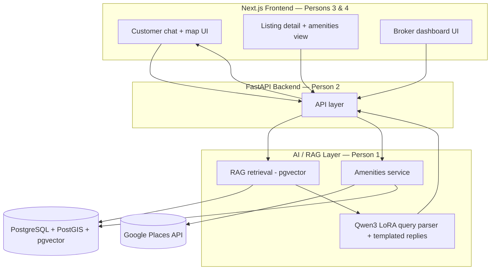

# Reality AI

**An AI-powered real estate exploration and publishing platform.**

Reality AI lets customers discover properties through a conversational, retrieval-grounded chat assistant paired with an interactive split-screen map — including free-form boundary search and cached nearby-amenities data — while brokers publish and manage listings and track engagement. Built as a final year project under the **AIDS (Artificial Intelligence & Data Science)** department, mentored by **Prof. Vivek Chapaneria**.

---

## Table of Contents

- [Overview](#overview)
- [Key Features](#key-features)
- [Architecture](#architecture)
- [Tech Stack](#tech-stack)
- [Repository Structure](#repository-structure)
- [Getting Started](#getting-started)
- [Environment Variables](#environment-variables)
- [API Reference (Summary)](#api-reference-summary)
- [Roadmap](#roadmap)
- [Team & Ownership](#team--ownership)
- [Contributing](#contributing)

---

## Overview

Rather than filtering listings through static forms, a customer describes what they're looking for in plain language. The interface responds with a live-updating split-screen view — chat on one side, an interactive monochrome map and matching property list on the other — similar in spirit to a Google Maps search-results layout, but powered by a property-domain-specific AI assistant rather than a generic one.

The current phase uses **synthetic data** for both listings and brokers, so the full pipeline can be validated end-to-end before onboarding real users.

## Key Features

- **Conversational property search** — a fine-tuned, retrieval-augmented chat assistant that answers from real listing data instead of guessing, and stays scoped to real estate rather than acting as a general-purpose chatbot.
- **Split-screen chat + map experience** — chat and results update together, live, as the conversation evolves.
- **Rough-boundary search** — the backend and AI accept a hand-drawn polygon with the chat message, so a drawn boundary and a text query narrow results together. The map drawing tool in the frontend is still to be built.
- **Nearby-amenities enrichment** — each listing is enriched with cached nearby points of interest (schools, hospitals, restaurants, transit, parks) via the Google Places API, looked up once at listing-creation time — never fetched live during a search or chat request.
- **Broker publishing & analytics** — brokers create and manage listings and see views/leads per listing.
- **Production-phase roadmap item (not yet built):** AI-generated, layout-accurate room visualizations (naked and furnished) for an explorable view of a property — see each track's roadmap document for the proposed design.

## Architecture



A broker's published listing is written to the database, then both **embedded** (for semantic search) and **amenities-enriched** (via a cached Google Places lookup) — so it becomes fully discoverable through the chat assistant immediately, without either step happening live during a customer's search.

## Tech Stack

| Layer | Technology |
|---|---|
| Frontend | Next.js 16 (App Router) + React 19, Tailwind CSS 4, Zustand, `@vis.gl/react-google-maps` |
| Backend | FastAPI, SQLAlchemy + GeoAlchemy2, Alembic, python-jose + passlib |
| Database | PostgreSQL 16 + PostGIS (geospatial) + pgvector (embeddings), in Docker |
| AI / RAG | sentence-transformers (all-MiniLM-L6-v2), retrieval over pgvector with SQL filters |
| Fine-tuning | QLoRA via PEFT + bitsandbytes + trl on Qwen/Qwen3-4B-Instruct-2507 for query understanding (sentence -> JSON filters); replies are templated, not generated (see `ai/docs/ADR-002-qwen3-nlu-model.md`) |
| Compute | Local GPU (RTX 3050, Person 1) runs the model; Kaggle Notebooks (free tier) for training |
| External APIs | Google Maps JavaScript API, Google Places API (Nearby Search), optional Gemini for listing autofill |
| Data | Synthetic Surat listings, brokers and customers with real-world coordinates |

## Repository Structure

One repository for the whole platform. The backend and frontend were imported
from their original repositories with full history (`git subtree`), so every
teammate's commits are kept.

```
Reality-AI/
├── ai/          # Person 1 — query understanding (Qwen3 + rules), retrieval, embeddings, amenities
├── backend/     # Person 2 — FastAPI app, Alembic migrations, seed data, tests
├── frontend/    # Persons 3 & 4 — Next.js app (chat + map, listing pages, broker dashboard)
├── db/          # Database image (PostGIS + pgvector) and init script
├── docker-compose.yml   # The database
├── start.ps1    # Starts everything on the GPU machine
└── .env.example # Settings shared by ai/ and backend/
```

## Getting Started

The AI model needs an NVIDIA GPU (4 GB is enough). Everything runs on the GPU
machine; other machines can work on the frontend and backend with
`NLU_BACKEND=rules` or `PLACEHOLDER_MODE=true`.

**Prerequisites:** Python 3.12, Node.js 20.9+, Docker Desktop, Git.

**1. One-time setup** (from the repo root, PowerShell):

```powershell
python -m venv .venv
.venv\Scripts\Activate.ps1
pip install torch --index-url https://download.pytorch.org/whl/cu121
pip install -r ai\requirements.txt -r backend\requirements.txt
copy .env.example .env      # then set SECRET_KEY (instructions inside)
```

Put the trained LoRA adapter in `ai/finetune/adapters/` (see `ai/docs/ai-architecture.md`).
For the map, add `NEXT_PUBLIC_GOOGLE_MAPS_API_KEY` to `frontend/.env.local`
(`start.ps1` creates the file from `frontend/.env.example`).

**2. Start everything:**

```powershell
.\start.ps1
```

It starts the database, applies migrations, seeds demo data on the first run,
embeds listings, and opens the backend (http://localhost:8000, API docs at
`/docs`) and the frontend (http://localhost:3000) in their own windows.
`.\start.ps1 -Reseed` resets the demo data; `.\start.ps1 -Dev` runs the
frontend with hot reload.

Demo logins: `customer@reality.ai` / `customerpassword123` and
`admin@reality.ai` / `adminpassword123` (broker).

**Tests:**

```powershell
.venv\Scripts\python -m pytest ai                      # AI: 208 tests
cd backend; ..\.venv\Scripts\python -m pytest tests     # backend: 90 tests (needs the database)
cd frontend; npx pnpm lint; npx pnpm build             # frontend checks
```

## Environment Variables

The repo-root `.env` is read by both `ai/` and `backend/`; the frontend uses
`frontend/.env.local`. Both have commented examples (`.env.example`).

| Variable | File | Purpose |
|---|---|---|
| `DATABASE_URL` | `.env` | PostgreSQL connection string (Docker database on port 5433) |
| `SECRET_KEY` | `.env` | Signs login tokens; at least 32 characters |
| `PLACEHOLDER_MODE` | `.env` | `false` runs the real AI; `true` returns canned replies |
| `NLU_BACKEND` | `.env` | `hybrid` (model + rules, GPU) or `rules` (no GPU) |
| `CORS_ORIGINS` | `.env` | Frontend URLs allowed to call the API |
| `GOOGLE_PLACES_API_KEY` | `.env` | Nearby-amenities lookups (once per listing, never during chat) |
| `HF_TOKEN` (optional) | `.env` | Hugging Face downloads |
| `NEXT_PUBLIC_API_URL` | `frontend/.env.local` | Backend URL |
| `NEXT_PUBLIC_GOOGLE_MAPS_API_KEY` | `frontend/.env.local` | Maps JavaScript API |
| `NEXT_PUBLIC_GOOGLE_MAPS_MAP_ID` (optional) | `frontend/.env.local` | Custom map style |
| `GEMINI_API_KEY` (optional) | `frontend/.env.local` | Broker listing autofill (server-side only) |

## API Reference (Summary)

| Method | Path | Purpose |
|---|---|---|
| `POST` | `/auth/register` / `/auth/login` | Broker or customer auth |
| `GET` | `/auth/me` | The logged-in user |
| `POST` | `/chat` | Customer chat message; AI search + reply |
| `GET` | `/chat/{id}` | Conversation history |
| `POST` | `/listings` | Broker publishes a listing; triggers embedding + amenities caching |
| `GET` / `PATCH` / `DELETE` | `/listings/{id}` | Fetch (public), edit or withdraw a listing |
| `PATCH` | `/listings/{id}/status` | available / under_offer / sold / withdrawn |
| `POST` | `/listings/{id}/images` | Upload a photo (JPEG/PNG, 5 MB) |
| `GET` | `/listings/search` | Radius-based search |
| `POST` | `/listings/search-boundary` | Polygon (hand-drawn) boundary search |
| `POST` | `/listings/{id}/leads` | "Contact broker": enquiry + broker phone |
| `GET` | `/listings/{id}/leads/mine` | The customer's own enquiry, to see the phone again |
| `GET` | `/brokers/{id}/public` | Public broker profile and visible listings |
| `GET` | `/brokers/{id}/analytics` / `listings` / `leads` | Broker dashboard data |
| `PATCH` | `/leads/{id}` | Broker updates an enquiry's follow-up status |
| `GET` | `/localities` | Surat areas the AI search knows |

Interactive documentation with every request and response shape is at
http://localhost:8000/docs while the backend runs.

## Roadmap

The project runs across **13 weeks**, in two parallel tracks (AI/backend, frontend) synced by phase gates:

| Phase | Weeks | Focus |
|---|---|---|
| 0 | 1 | Foundation & environment setup |
| 1 | 2–4 | Core data layer / core customer experience |
| 2 | 5–6 | Real AI + backend integration |
| 3 | 7–8 | Boundary search (compulsory) |
| 4 | 9 | Amenities enrichment (compulsory) |
| 5 | 10 | Performance, testing & polish |
| 6 | 11–13 | Documentation, demo prep & submission |

Full per-person, per-phase detail (objectives, tasks, gate criteria) is in each track's roadmap document under `docs/`.

## Team & Ownership

| Track | Owner(s) | Scope |
|---|---|---|
| AI / RAG | Person 1 | RAG retrieval, LoRA fine-tuning (owns the local GPU), amenities service |
| Backend | Person 2 | FastAPI, PostgreSQL/PostGIS, all API endpoints |
| Frontend | Persons 3 & 4 | React app — chat/map UI (Person 3, lead), supporting components & QA (Person 4) |

| Enrollment No. | Role |
|---|---|
| ET23BTAI043 | Team Leader |
| ET23BTAI005 | Team Member |
| ET23BTAI054 | Team Member |
| ET23BTAI026 | Team Member |

## License

Proprietary. © 2026 harshpasiya. All rights reserved. No copying, sharing, modification or sale
without the author's prior written agreement. See [LICENSE](LICENSE). 

## Contributing

This repo uses a **fork-and-pull-request** workflow, not direct pushes:

1. Get added as a collaborator (Read access) so the private repo is visible to you.
2. Fork `reality-ai` to your own account and clone your fork.
3. Branch off `main`, make your change, and push to your fork.
4. Open a pull request from your fork's branch back into this repo's `main`.

Full step-by-step commands are in [`docs/Reality-AI-Initial-Setup-Guide.md`](docs/Reality-AI-Initial-Setup-Guide.md).
